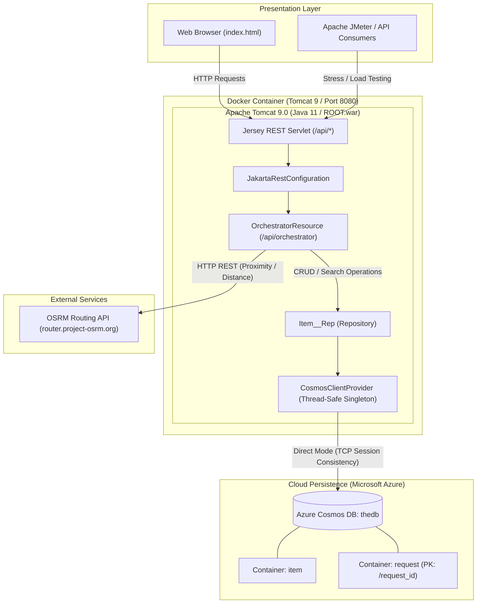

# CycleNest Orchestrator — Architecture & Containerisation

In this project, I containerised and architected my CycleNest Orchestrator service so I can build and run it in a consistent environment without relying on a local Tomcat/Maven setup. My container exposes the REST endpoints via Tomcat on port 8080.

## System Architecture

CycleNest Orchestrator follows a service-oriented, layered architectural pattern acting as an **API Gateway / Orchestrator**. It unifies catalog browsing, rental lifecycle management, and external geospatial route calculations behind a single, resilient REST API.

### High-Level Architecture Diagram



### Architectural Layers & Core Components

1. **Presentation Layer (Web Client & Consumers)**
   - **Static Single-Page UI (`index.html`)**: Hosted at the root of the Tomcat container (`http://localhost:8080/`), allowing users to search bicycles, check route distances, and create or cancel rental requests.
   - **External Clients & Load Testers**: Automated test suites such as Apache JMeter and HTTP clients (`curl`, Postman) communicating with the backend over JSON/REST.

2. **API & Orchestration Layer (Jersey / JAX-RS on Tomcat 9)**
   - **Jersey Servlet Container (`web.xml`)**: Intercepts requests matching `/api/*` and routes them to registered JAX-RS components.
   - **Application Configuration (`JakartaRestConfiguration`)**: Extends `javax.ws.rs.core.Application` to register and initialize the orchestrator resource.
   - **Orchestrator Resource (`OrchestratorResource`)**: The central REST controller exposing:
     - `GET /api/orchestrator/proximity`: Validates coordinates and coordinates calls to the OSRM routing engine.
     - `GET /api/orchestrator/items`: Executes multi-parameter search queries (location, category, maxPrice, availability).
     - `POST /api/orchestrator/requests`: Validates availability and generates new rental requests.
     - `PUT /api/orchestrator/requests/{requestId}/cancel`: Updates request status to `cancelled`.

3. **Data Access & Client Management Layer**
   - **Thread-Safe Singleton Provider (`CosmosClientProvider`)**: Maintains a single, shared `CosmosClient` across all incoming requests using double-checked locking and tuned direct-mode TCP connections (`maxConnectionsPerEndpoint=20`, `maxRequestsPerConnection=30`). This prevents socket exhaustion under high concurrent load.
   - **Repository (`Item__Rep`)**: Encapsulates parameterized SQL queries against Azure Cosmos DB to prevent injection, and manages document creation/upsert operations.

4. **Persistence Layer (Azure Cosmos DB)**
   - **Database (`thedb`)**: Cloud-hosted NoSQL document database.
   - **`item` Container**: Stores bicycle inventory, specifications, rental rates, and coordinates.
   - **`request` Container**: Stores rental reservation requests partitioned by `/request_id`.

5. **External Integration (OSRM Routing Service)**
   - Calls the public Open Source Routing Machine (`http://router.project-osrm.org`) over HTTP with configured connect (`5000ms`) and read (`10000ms`) timeouts, comprehensive error handling (DNS, timeout, connection failures), and unit conversions (meters to kilometers, seconds to minutes).

---


## How I use containerisation in my implementation
I use Docker to package my application and its runtime into a portable image that runs the same way across machines. This helps me to:

- **Standardise my runtime**: I run my service on a known Tomcat 9 + Java 11 environment every time.
- **Improve portability**: I can move my service between devices without reconfiguring Tomcat locally.
- **Separate build and runtime concerns**: Maven is only used in the build stage, while the runtime image contains only Tomcat and my WAR.
- **Expose my REST API consistently**: I map port `8080` from the container to my host so my endpoints are always reachable at `http://localhost:8080/...`.

## How my containerisation works
I use a **multi-stage Docker build**:

1. **Build stage (Maven + Java 11):**
   - I compile my code and package it into a **WAR** file using Maven.
   - This produces the WAR under `target/`.

2. **Runtime stage (Tomcat 9 + Java 11):**
   - I deploy the WAR into Tomcat as `ROOT.war`.
   - Deploying as `ROOT.war` means my service runs at the root context:
     - Base URL: `http://localhost:8080/`
     - REST base path: `http://localhost:8080/api/...`

This approach keeps my runtime image clean (Tomcat only) while still allowing Maven to build the application.

## Prerequisites
- Docker Desktop installed and running

## Running my service with Docker

### 1) Build the Docker image
From the project root (the folder that contains `pom.xml` and `src/`), I run:

```bash
docker build -t cycle-nest-orchestrator:latest .
```

### 2) Run the container
I start the container and expose Tomcat on port 8080:

```bash
docker run --rm -p 8080:8080 --name orchestrator cycle-nest-orchestrator:latest
```

- `-p 8080:8080` makes the REST API available on my machine
- `--rm` removes the container automatically when I stop it

## Testing my REST API

### Proximity endpoint (example)
I test my proximity endpoint using PowerShell:

```powershell
curl.exe -i "http://localhost:8080/api/orchestrator/proximity?originLat=52.9548&originLng=-1.1581&destLat=52.9600&destLng=-1.1500"
```

Example successful response:

```json
{"distanceMeters":1402.4,"distanceKm":1.4024,"durationSeconds":222.8,"durationMinutes":3.7133333333333334,"osrmStatus":"Ok"}
```

## Notes
- If port `8080` is already in use, I stop the other service using it or run the container on a different port (e.g. `-p 8081:8080`).
- My proximity endpoint requires the correct parameter names: `originLat`, `originLng`, `destLat`, `destLng`.
